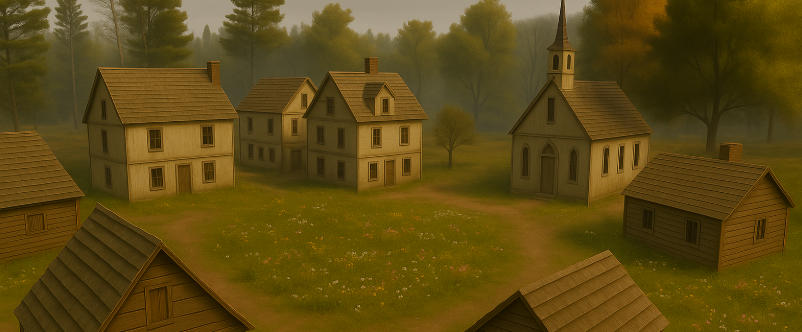
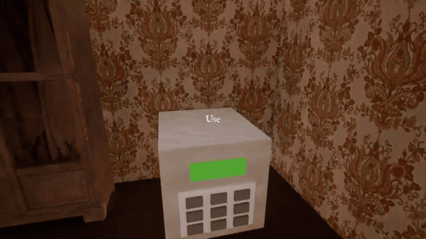
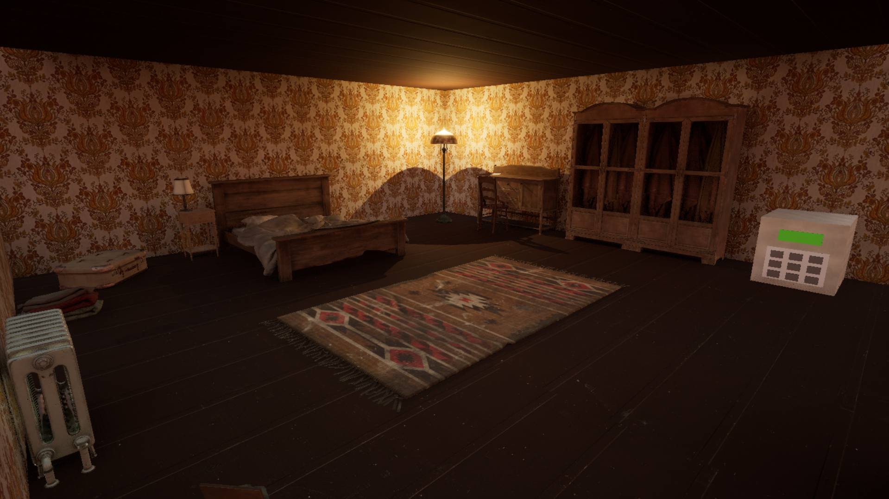
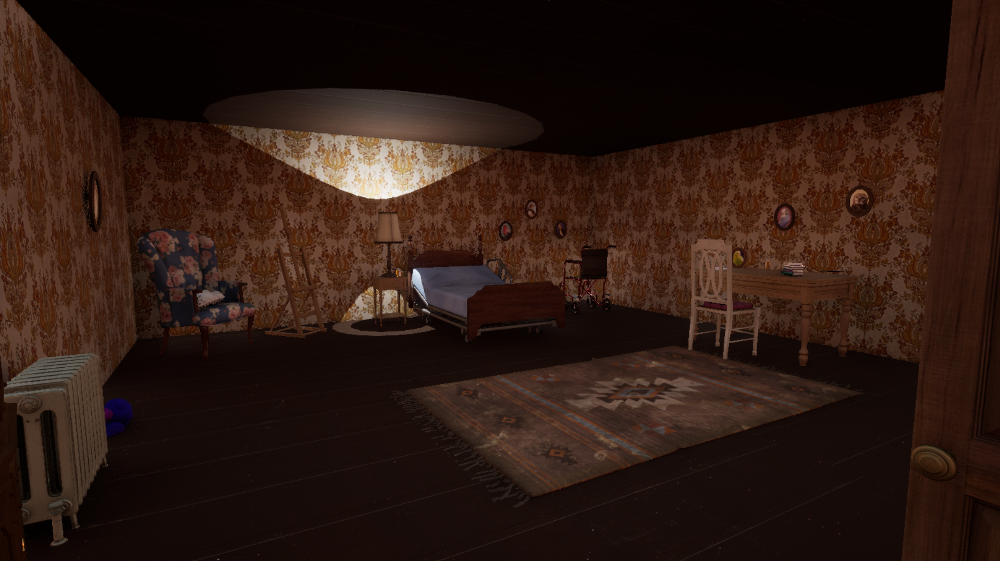
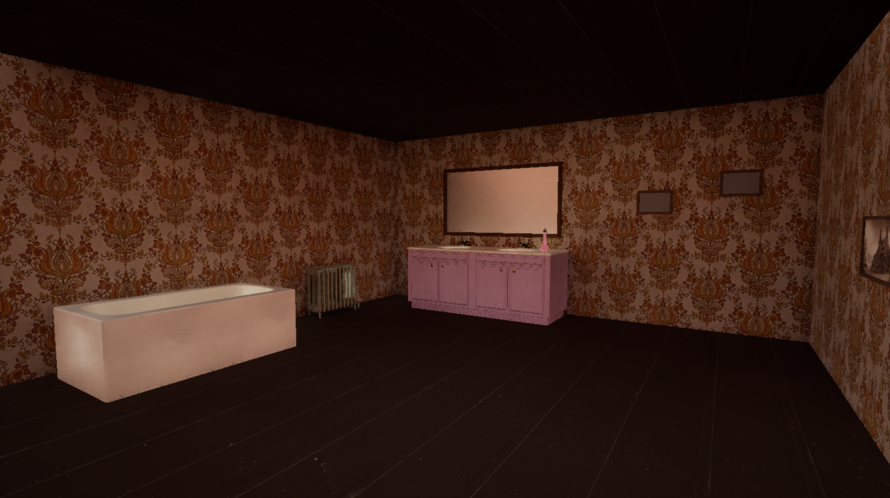
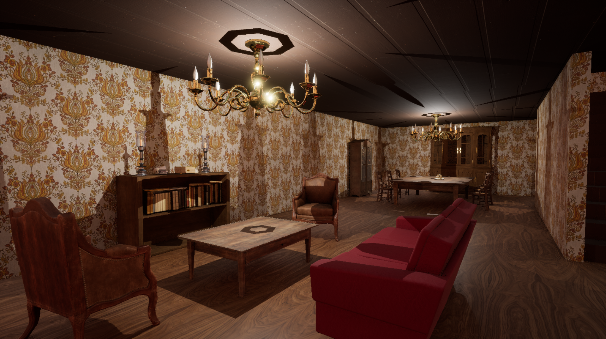
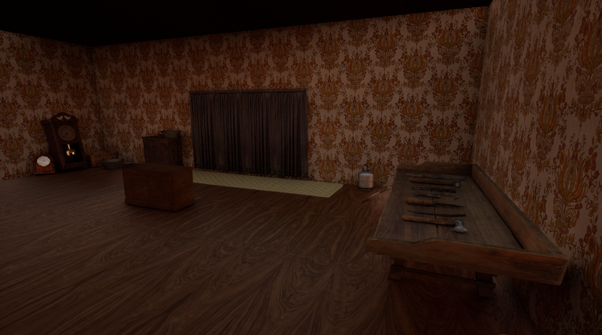
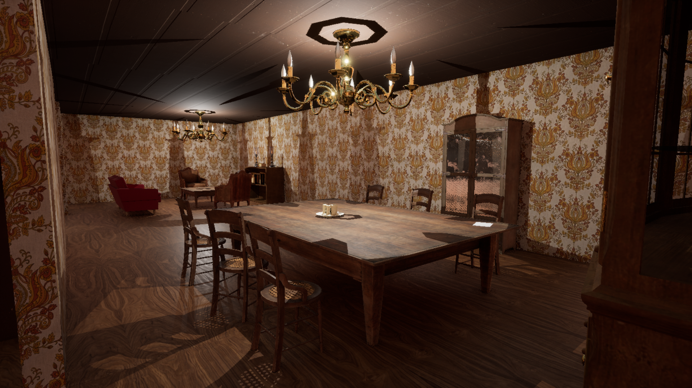

  

# Infirm

A single-player, first-person exploration and puzzle game set in a mysterious, abandoned house. Built in **Unreal Engine 5** with **C++**.

🎥 **[Watch the playthrough on YouTube](https://www.youtube.com/watch?v=xlBb9Ggb-xQ)** · 📦 **[Download the game (Windows)](#-download)** · 💻 **[Browse the code](#-source-code)**

---

## 📜 Description

Explore the house, read what the people who lived there left behind, search every corner, and solve puzzles to uncover the secrets hidden within. Each room holds clues, and each item could bring you closer to the truth.

Gather the four ritual items described in the notes you find (a candle, salt, a token belonging to the afflicted, and the incantation) and bring them together to complete the ritual.

  
  
  

## 🖥️ Development

Infirm was built as an atmospheric, single-player experience inspired by Colonial Massachusetts in the 1600s. Small details, such as unusual objects and modern conveniences, quietly disrupt the sense of place and leave the player questioning when the story is meant to take place.

All gameplay and UI logic is written in **C++**. The world is assembled from freely available assets, shaped and combined to feel cohesive. The project was developed alongside other commitments, over several months of iteration.

---
## 🎮 Gameplay

### Screenshots

  
  
  

  
  
  

## 🧩 Technical Overview

| System | Key classes | What it does |
| --- | --- | --- |
| Player | `AFirstPersonPlayer` | First-person movement and look using **Enhanced Input**; equips, holds and drops items |
| Controller / UI flow | `AFirstPersonController` | Owns widget lifecycle (notes, prompts, safe keypad, pause, main menu), input modes and the player inventory |
| Interactables | `APickable`, `ASearchable`, `ADoor`, `ADrawer`, `ASafeDoor` | Overlap-driven prompts and interactions: pick up, search, open, unlock |
| Puzzle completion | `AGrabber`, `AEndGameModeBase` | Accepts the ritual items onto sockets and loads the ending once all four are placed |
| Reusable components | `UMover`, `UTriggerComponent` | Data-driven movement/rotation triggered by an item entering a volume |
| UI | `UNoteWidget`, `USafeDoorWidget`, `UDisplayWidget`, `UPauseWidget`, `UMainMenuWidget` | UMG widgets with logic implemented in C++ |

## 🔍 Known Limitations & What I'd Refactor

This was a learning project, and a few things I'd do differently with more time:

- **Inventory:** Items are tracked with individual booleans plus tags copied onto the player. A single `TSet<FName>` (or Gameplay Tags) would remove a lot of duplicated branching.
- **Interaction dispatch:** The player routes interactions with actor tags and casts. An `IInteractable` interface would be cleaner and easier to extend.
- **Targeting:** Interactions use proximity overlaps instead of a line trace from the camera, so overlapping interactables can compete.

## 📦 Download 
Click [here](https://drive.google.com/drive/u/1/folders/1J4NOSFp35yeTLK3PGWlECyoCejMM9fZR) to download the game!

**[Download the game here](https://drive.google.com/drive/u/1/folders/1J4NOSFp35yeTLK3PGWlECyoCejMM9fZR)** (Windows)

1. Open the link above
2. Download the zip folder
3. Unzip it and open the `Windows` folder
4. Run `Infirm.exe` and enjoy!

## 💻 Source Code

The C++ source is in the [`Source/`](Source/) folder. The Unreal `Content/` folder (levels, meshes, textures, audio, widget layouts) is not included because of its size and third-party asset licenses, so the project will not build from this repository alone.

## 🛠️ Credits
### 🎵 Music
**Main Menu Theme:** "Scott Buckley - Balefire" is under a Creative Commons (BY 3.0) license:
https://creativecommons.org/licenses/... \
[musicbyscottb](https://www.youtube.com/user/musicbyscottb) \
Music powered by BreakingCopyright: [🔥 Dark Celtic Soundtrack (Free Music) ](https://www.youtube.com/watch?v=ln3k6NOLcJs)- "B...   
 \
**Ending Theme:** Relaxation and Meditation Nation - "Eerie Cornfield Soundscape Halloween Ambience Sounds/ Rustling Cornstalks Ravens Crows ASMR / 1 Hour". \
Link:  https://www.youtube.com/watch?v=VGgk3Kwq1vw. \
Author: [Relaxation and Meditation Nation](https://www.youtube.com/@relaxationmeditationnation)
